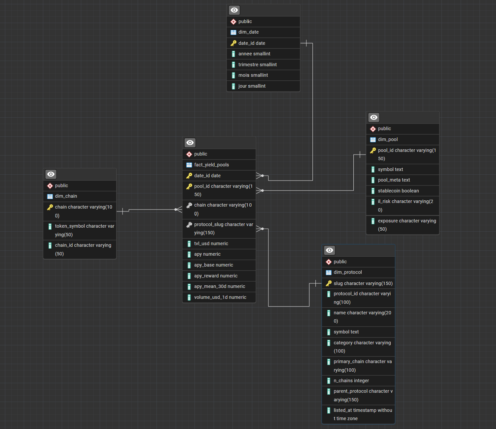
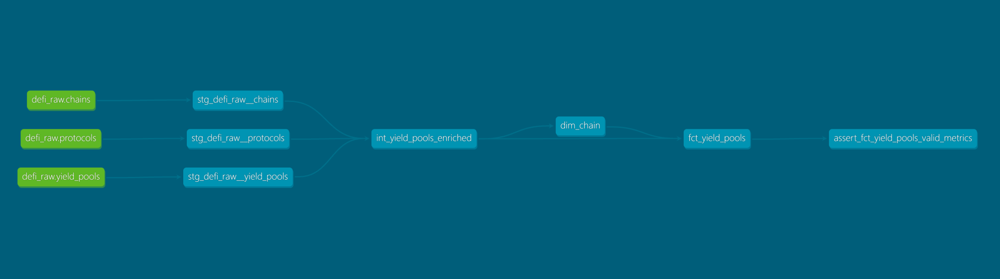
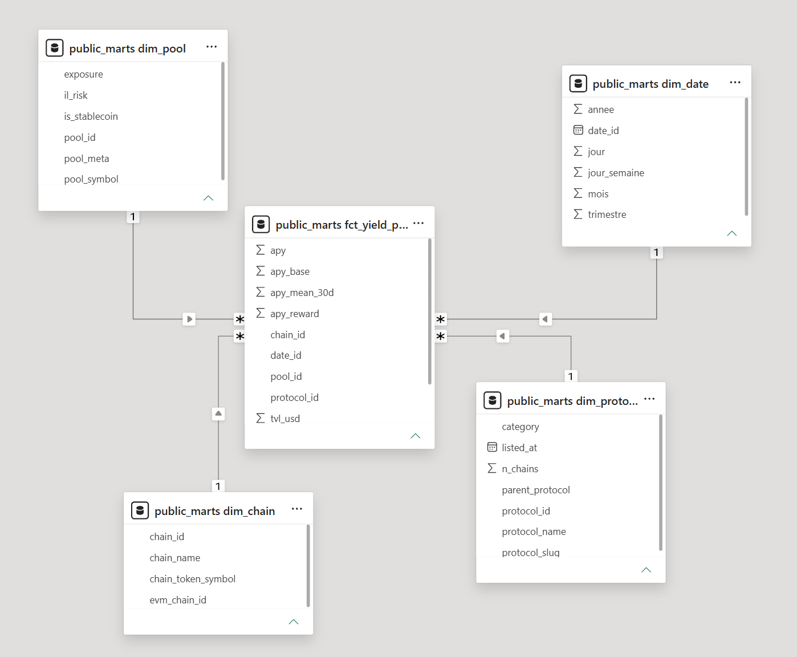
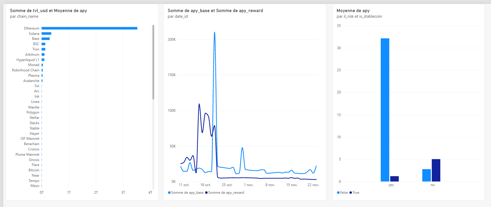

# 📊 DeFi Analytics — Pipeline ELT, Optimisation SQL (10M lignes) & Modélisation dbt


Projet d'ingénierie des données de bout en bout autour de la **Finance Décentralisée (DeFi)** : de la modélisation relationnelle et l'optimisation de requêtes sur **10 millions de lignes** sous PostgreSQL, jusqu'à l'industrialisation d'un pipeline **ELT** avec **dbt** et la restitution décisionnelle sous **Power BI**.

---

## 🎯 Contexte & Question métier

Dans l'écosystème DeFi, des milliers de pools de rendement proposent des taux très variables selon les blockchains, les protocoles et le niveau de risque encouru. Ce projet répond à la problématique suivante :

> **« Quel pool de finance décentralisée présente le meilleur compromis entre rendement, liquidité et indicateurs de risque selon les blockchains et les protocoles ? »**

**Axes d'analyse :**
1. Classement des blockchains et catégories de protocoles par liquidité (**TVL**) et rendement moyen (**APY**).
2. Dynamique quotidienne des rendements (**APY de base** vs **APY reward**) sur la période réelle observée (**39 jours**, du `10/10/2026` au `23/11/2026`).
3. Comparaison rendement / risque entre pools sûrs (`stablecoin = True`, `il_risk = no`) et pools exposés à l'Impermanent Loss.

---

## 📦 Données sources & Dictionnaire des variables

- **Source Kaggle :** [DeFi Daily: TVL, Stablecoins, DEX & Yields](https://www.kaggle.com/datasets/danielaijdkx/defi-daily-tvl-stablecoins-dex-yields)
- **Origine & Licence :** API publique **DefiLlama** (données quotidiennes en USD, dates UTC — utilisation publique avec attribution).
- **Périmètre pure DeFi :** Parmi les 12 fichiers du dataset, nous avons retenu les 3 tables relationnellement liées (`chains_snapshots.parquet` — 16 661 lignes, `protocols_snapshots.parquet` — 256 933 lignes, `yield_pools_snapshots.parquet` — 103 211 lignes) et exclu les plateformes centralisées (`category = 'CEX'`) afin de conserver uniquement la finance décentralisée.

| Variable | Signification métier |
| :--- | :--- |
| **`tvl_usd`** | *Total Value Locked* — montant total des capitaux déposés dans un pool ou un protocole (en USD). |
| **`apy`** | *Annual Percentage Yield* — rendement annuel total estimé du pool (`apy_base + apy_reward`, en %). |
| **`apy_base`** | Rendement organique issu des frais générés par l'activité du pool. |
| **`apy_reward`** | Rendement incitatif distribué en jetons bonus par le protocole. |
| **`il_risk`** | *Impermanent Loss Risk* (`yes` / `no`) — risque de perte liée à la divergence de prix entre jetons du pool. |
| **`is_stablecoin`** | Indique si le pool est composé uniquement de stablecoins (actifs indexés sur une monnaie stable, ex. USD). |
| **`exposure`** | Type d'exposition du placement (`single` = 1 jeton, `multi` = plusieurs jetons). |
| **`protocol_slug` / `parent_protocol`** | Identifiant du protocole (ex. `uniswap-v2`) et maison-mère éventuelle (ex. `parent#uniswap`). |

---

## 🗂️ 1. Modélisation relationnelle (TP1 — PostgreSQL)

Conception d'un schéma relationnel physique normalisé à **5 tables** (`sql/00_creation_schema.sql`) avec clés primaires simples et composées, clés étrangères (`REFERENCES`), typage financier exact (`NUMERIC`) et contraintes d'intégrité (`CHECK (tvl_usd >= 0)`).

- **Volume initial pure DeFi chargé via Python (`pg8000`) :** `100 307` lignes de faits (`dim_date` : 39, `dim_chain` : 68, `dim_protocol` : 7 409, `dim_pool` : 3 375).



---

## 🧮 2. Requêtes SQL avancées (TP1 & TP2)

Le script `sql/02_requetes_avancees.sql` regroupe les requêtes fondamentales (jointures, sous-requêtes scalaires, `GROUP BY` / `HAVING`, `LEFT JOIN ... IS NULL`) et **6 requêtes analytiques avancées** :
1. **Classement (`ROW_NUMBER`) :** Top 3 des pools les plus rentables par blockchain ($\text{TVL} \ge 5\text{M\$}$).
2. **Comparaison temporelle (`LAG`) :** Variation quotidienne de l'APY par rapport à la veille sur les gros pools Ethereum.
3. **Segmentation (`NTILE`) :** Découpage des pools en 4 quartiles de liquidité et comparaison de l'APY moyen.
4. **Fenêtre glissante (`ROWS BETWEEN`) :** Moyenne mobile sur 7 jours de l'APY et cumul des volumes journaliers.
5. **Hiérarchie (`WITH RECURSIVE`) :** Parcours parent $\rightarrow$ enfant entre maisons-mères (`parent_protocol`) et protocoles (`slug`).
6. **Pipeline multi-CTEs (`WITH` enchaînés) :** Filtrage, agrégation sur $\ge 30$ jours et classement `DENSE_RANK` par catégorie.

---

## ⚡ 3. Passage à l'échelle (10M lignes) & Benchmarks (`EXPLAIN ANALYZE`)

Pour évaluer les performances en conditions réalistes, `fact_yield_pools` a été portée à **10 030 700 lignes** (`sql/01_generation_volume.sql`) via `CROSS JOIN generate_series(1, 99)`, décalage temporel de 45 jours sans collision de clé primaire, variation aléatoire via `random()`, puis mise à jour des statistiques (`ANALYZE`).

Protocole appliqué sur 3 requêtes (médiane de 3 exécutions à cache chaud, `EXPLAIN (ANALYZE, BUFFERS)`) avec création d'index dans `sql/03_index.sql` :

| Benchmark | Médiane Avant (`Exec. Time`) | Opérateur Avant | Index créé (`03_index.sql`) | Médiane Après (`Exec. Time`) | Opérateur Après | Enseignement clé |
| :--- | :--- | :--- | :--- | :--- | :--- | :--- |
| **B1** — Agrégat Solana ($\text{TVL} \ge 10\text{M\$}$) | 1 741 ms (`1527.1 ms`) | `Parallel Seq Scan` (`164 596` buffers) | Composite `(chain, tvl_usd)` | 735 ms (`709.9 ms`) | `Parallel Seq Scan` | **Index non retenu** : ~367k lignes dispersées (3,7 %), la lecture séquentielle reste optimale. |
| **B2** — `LAG` `uniswap-v2` (`LIMIT 50`) | 73 ms (`36.8 ms`) | `Index Scan` PK (`32 263` buffers) | Couvrant `INCLUDE (pool_id, tvl_usd, apy)` | 125 ms (`68.1 ms`) | `Index Only Scan` (`552` buffers, `Heap Fetches: 0`) | **-98,3 % de lectures buffers** sans accès table, mais `LIMIT 50` favorisait l'arrêt précoce avant. |
| **B3** — `RANK` pools $\ge 500\text{M\$}$ (`LIMIT 50`) | 927 ms (`2124.5 ms`) | `Parallel Seq Scan` + `Disk Sort` (`164 594` buffers) | Composite `(chain, tvl_usd)` + Partiel | 76 ms (**`4.75 ms`**) | `Index Scan` (`3 461` buffers) | **~447× plus rapide** (`Exec. Time`) : l'index pré-trié par `chain` supprime le tri sur disque. |

📄 Voir l'analyse complète et les plans bruts dans **[`docs/rapport_performance.md`](docs/rapport_performance.md)**.

---

## 🔄 4. Pipeline ELT avec dbt & Schéma en étoile OLAP

En mode **ELT**, les 3 fichiers Parquet bruts sont chargés sans transformation dans le schéma **`raw`** (`scripts/load_raw.py`), puis **`dbt`** orchestre la transformation vers un schéma en étoile analytique (`public_marts`) :

- **`staging` (`view`) :** Nettoyage, typage (`::date`, `::numeric`, `::integer`), normalisation (`trim`, `lower`), clés composites et tests `not_null`, `unique`, `accepted_values`.
- **`intermediate` (`view`) :** Jointures multi-sources sur `(snapshot_date, clé)` sans duplication, exclusion des `CEX` (pure DeFi) et tests `relationships`.
- **`marts` (`table`) :** Modélisation Kimball (`dim_date`, `dim_chain`, `dim_protocol`, `dim_pool`, `fct_yield_pools`) avec clés de substitution déterministes (`md5`), tests relationnels et **test métier personnalisé** (`assert_fct_yield_pools_valid_metrics.sql`).
- **`snapshots` (SCD Type 2) :** Historisation des évolutions des protocoles (`snap_protocols.sql`, stratégie `check`).
- **Validation :** `dbt build` validé avec **53/53 tests `PASS` (0 erreur)**.





---

## 📈 5. Visualisation Power BI

Le tableau de bord Power BI connecté directement à `public_marts` restitue les 3 axes métier :
1. **Top Blockchains par TVL** au `23/11/2026` *(filtré sur la dernière date pour éviter le double comptage de la TVL semi-additive)*.
2. **Évolution quotidienne `APY base` vs `APY reward`** sur les 39 jours réels.
3. **Comparaison rendement moyen selon le risque (`il_risk` et `is_stablecoin`)**.



---

## 📁 Arborescence du projet

```text
defi_analytics/
├── .gitignore
├── README.md
├── docs/
│   ├── guide_migration.md             # Guide de création base & import Python -> PostgreSQL
│   ├── rapport_performance.md         # Benchmarks EXPLAIN ANALYZE avant / après & analyse
│   ├── schema_relationnel.png         # Schéma relationnel PostgreSQL (TP1)
│   ├── schema_etoile.png              # Schéma en étoile OLAP final (Power BI / dbt)
│   ├── dbt_lineage.png                # Graphe de lignage dbt docs
│   ├── powerbi_dashboard.png          # Capture du tableau de bord Power BI
│   └── defi_dashboard.pbix            # Classeur Power BI Desktop
├── scripts/
│   ├── inspect_data.py                # Audit des fichiers CSV / Parquet
│   ├── load_to_postgres.py            # Chargement TP1 dans public (pg8000)
│   └── load_raw.py                    # Chargement brut ELT dans raw (pg8000)
├── sql/
│   ├── 00_creation_schema.sql         # DDL TP1 (PK, FK, CHECK)
│   ├── 01_generation_volume.sql       # Génération rejouable à 10 030 700 lignes + ANALYZE
│   ├── 02_requetes_avancees.sql       # Requêtes TP1 + 6 requêtes avancées TP2
│   └── 03_index.sql                   # Index B-tree composite, couvrant (INCLUDE) et partiel
└── defi_dbt/
    ├── dbt_project.yml
    ├── models/
    │   ├── staging/                   # _sources.yml, _staging.yml, stg_defi_raw__*.sql
    │   ├── intermediate/              # _intermediate.yml, int_yield_pools_enriched.sql
    │   └── marts/                     # _marts.yml, dim_*.sql, fct_yield_pools.sql
    ├── snapshots/                     # snap_protocols.sql (SCD Type 2)
    └── tests/                         # assert_fct_yield_pools_valid_metrics.sql
```

---

## 🚀 Reproduire le projet en local

1. **Environnement Python :**
   ```bash
   python -m venv .venv
   source .venv/Scripts/activate   # Windows Git Bash
   pip install pandas pyarrow pg8000 dbt-postgres
   ```
2. **Base PostgreSQL (TP1 & TP2) :**
   - Créer la base `defi_analytics`, exécuter `sql/00_creation_schema.sql`, charger les données via `scripts/load_to_postgres.py`, puis générer les 10M de lignes avec `sql/01_generation_volume.sql`.
3. **Pipeline ELT dbt :**
   ```powershell
   python scripts/load_raw.py
   cd defi_dbt
   python -m dbt.cli.main debug
   python -m dbt.cli.main build
   python -m dbt.cli.main docs generate
   python -m dbt.cli.main docs serve
   ```

---

## 👥 Équipe & Organisation Git
- **Membres :** Audrey Mbeuyo & Huyen Tran
- **Workflow Git :** développement sur branches thématiques (`feature/dbt-staging`, `feature/dbt-intermediate`, `feature/dbt-marts`) avec revue et fusion vers `main`.